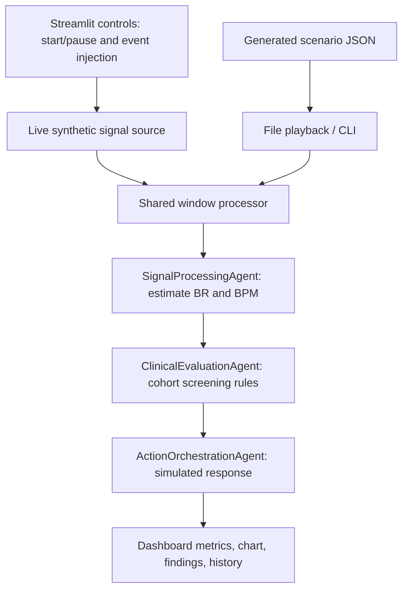

# mmWave-BioAgent

An interactive, local demonstration of a **LangGraph multi-agent radar-signal
pipeline** for Infant Safety and Elderly Care. A Streamlit dashboard generates
synthetic phase-displacement signals, estimates physiological rates, applies
cohort screening rules, and displays simulated responses.

> **Research/software demonstration only.** No physical radar is connected.
> This is not a validated clinical monitor, diagnosis tool, or emergency-response
> system. All alerts and actions are simulated; no parent notifications,
> nurse-station dispatches, alarms, or database writes occur.

## Features

- **Live synthetic stream:** start/pause, manual advancement, and reset.
- **Infant Safety:** inject breathing suppression and restore breathing manually.
- **Elderly Care:** queue a single displacement spike to demonstrate fall screening.
- **Agent visibility:** inspect signal telemetry, screening findings, and simulated actions.
- **Dashboard:** rolling signal chart, estimated breathing/heart rates, simulated
  time, undetected-respiration duration, and the latest 100 live window results.
- **Mock file playback:** step through generated infant/elderly scenarios.
- **CLI demo:** use the same graph and window processor without Streamlit.
- **Regression tests:** signal processing, input validation, event injection,
  window coverage, and Streamlit interactions.

The agents are deterministic Python DSP/rule components orchestrated by LangGraph,
not LLM agents. The implemented pipeline needs no API keys, model downloads, GPU,
or external inference service.

## Architecture



| Component | Responsibility |
|---|---|
| [Graph](src/app.py) | Defines shared state, nodes, and the sequential compiled `app_graph`. |
| [Simulation](src/simulation.py) | Synthetic source, scenario loading, window processing, and CLI driver. |
| [Streamlit UI](src/streamlit_app.py) | Session-local controls and result presentation. |
| [Signal agent](src/agents/signal_agent.py) | Validates the cohort and maps DSP results to telemetry. |
| [DSP](src/dsp/filters.py) | Input checks, stable bandpass filtering, and spectral rate estimation. |
| [Clinical agent](src/agents/clinical_agent.py) | Evaluates telemetry without hiding simultaneous findings. |
| [Action agent](src/agents/action_agent.py) | Returns explicitly labeled `SIMULATED_ACTION` messages. |
| [Configuration](src/utils/config.py) | Cohort screening thresholds and shared validation. |

`src/app.py` is the reusable graph module, **not the UI or simulation entry point**.
Streamlit uses helpers from `src/simulation.py`; it does not call the CLI's
`run_langgraph_simulation()` function.

## Setup

Run commands from the project root in PowerShell. Use Python 3.10 or newer;
the application has previously been tested locally with Python 3.13.

```powershell
python -m venv .venv
.\.venv\Scripts\python.exe -m pip install numpy scipy "streamlit>=1.37" langgraph
```

These are the dependencies used by the implemented radar demo. The current
[requirements.txt](requirements.txt) also contains broader AI/model dependencies
that are not used by this pipeline. To install that entire environment instead:

```powershell
.\.venv\Scripts\python.exe -m pip install -r .\requirements.txt
```

No virtual-environment activation or `.env` file is needed for the demo.

## Launch the Dashboard

```powershell
.\.venv\Scripts\python.exe -m streamlit run .\src\streamlit_app.py
```

Open the local URL printed by Streamlit, normally `http://localhost:8501`.
To use a specific local port:

```powershell
.\.venv\Scripts\python.exe -m streamlit run .\src\streamlit_app.py --server.address 127.0.0.1 --server.port 8517
```

### Live Synthetic Stream

1. Select **Live synthetic stream** and choose **Infant Safety** or **Elderly Care**.
2. Click **Start** for automatic updates, or use **Advance 2 simulated seconds**
   while paused.
3. Inspect the estimated rates, raw signal, agent results, and history.
4. Pause or reset the demo when finished.

The first update initializes **10 seconds / 200 samples**. Later updates add
**2 seconds / 40 samples**, keeping a rolling ten-second window at 20 Hz.
Automatic fragment refresh is scheduled every two seconds; simulated time is
sample-based and is not guaranteed to match wall-clock time. UI interactions
while running can also cause processing updates.

#### Infant Safety walkthrough

1. Initialize a normal signal.
2. Click **Inject apnea** to suppress the generated respiratory component.
3. Continue streaming or advancing to observe the changed estimates and findings.
4. Click **Restore breathing** to resume the respiratory component.

Suppression stays active until restored. The source also changes the synthetic
cardiac component during suppression. Detection and recovery can lag while old
samples leave the window. An injected event changes the signal, **not the
screening status directly**.

#### Elderly Care walkthrough

1. Initialize a normal signal.
2. Click **Inject fall**.
3. Advance the stream to insert a single `-8.5` displacement spike.
4. Inspect the potential-fall finding and simulated nurse-station response.

The queued spike is consumed on the next update. Only newly covered samples
are inspected for a spike, avoiding duplicate fall flags from overlapping windows.
It is a displacement heuristic, not a velocity estimate or confirmed fall.

Live state is isolated per Streamlit session. **Reset live demo** and changing
care cohorts clear live progress. Switching to file mode pauses the live source.
Live history is in memory only and retains at most 100 results.

### Mock File Playback

Generate the files first if they do not already exist:

```powershell
.\.venv\Scripts\python.exe .\data\generate_mock_data.py
```

**This overwrites the three generated JSON files.** Run it from the project root,
because generator output paths are relative to the working directory.

In the dashboard, select **Mock file playback**, choose a scenario, and click
**Process next window**. **Reset demo** restarts playback; changing scenarios
also clears file-playback progress. A 600-sample scenario has 11 complete windows,
including the final `[400:600]` window.

| Generated file | Contents |
|---|---|
| `data/raw/raw_radar_target.json` | 60 seconds / 1,200 samples of adult-like signal, with timestamps. |
| `data/simulated/infant_apnea.json` | 30 seconds / 600 samples with no respiratory component; infant, age 3 months. |
| `data/simulated/elderly_fall.json` | 30 seconds / 600 samples with a spike at sample 100; elderly, age 82 years. |

Each scenario represents **one synthetic subject**, not multiple patients.
Age metadata is descriptive; the rules use only the infant/elderly cohort.
The raw adult file has a different schema and is **not** accepted directly by
the scenario loader, which expects a `signal` array. Adult is not a supported
clinical cohort.

## CLI Demo

```powershell
.\.venv\Scripts\python.exe -m src.simulation infant
.\.venv\Scripts\python.exe -m src.simulation elderly
```

The CLI processes all windows and prints simulated action results without a
dashboard. Default scenario paths resolve relative to the project location.
Paths supplied to the Python scenario-loading API resolve relative to the
caller's working directory. Missing/invalid scenarios fail explicitly.

## Screening Rules and Interpretation

Current demonstration defaults in [config.py](src/utils/config.py):

| Setting | Infant | Elderly |
|---|---:|---:|
| Breathing-rate bounds (breaths/min) | 25-60 | 12-20 |
| Heart-rate bounds (beats/min) | 100-160 | 50-100 |
| Persistent undetected-respiration limit | 15 seconds | 20 seconds |
| Displacement-spike screening | Disabled | Enabled above absolute amplitude 8.0 |

- **NORMAL:** estimates lie within configured cohort bounds.
- **WARNING:** out-of-bound rates or respiration not detected before its duration limit.
- **CRITICAL:** a potential-fall spike or persistent undetected respiration at/above
  its duration limit. Concurrent rate abnormalities remain in the findings.

The duration counter accumulates consecutive zero-respiration estimates without
double-counting window overlaps and resets when a respiratory component is
detected. It measures **estimated undetected-respiration time**, not independently
observed apnea duration. With two-second updates, a 15-second threshold can be
crossed at a later update rather than exactly at 15 seconds.

Signals must be finite, one-dimensional, and at least ten seconds long.
Invalid/insufficient input raises an error rather than returning a flatline.
Rate estimation uses a detrended, Hann-windowed spectrum of the original signal;
bandpass waveforms use second-order-section zero-phase filtering.

| Agent band | Infant | Elderly |
|---|---|---|
| Respiratory | 0.1-1.0 Hz | 0.1-0.5 Hz |
| Cardiac | 1.0-2.5 Hz | 0.8-2.5 Hz |

The driver uses 20 Hz sampling. The DSP API requires sampling above 5 Hz.
Mock detection amplitude limits are 0.05 for respiration and 0.01 for cardiac
components. These are heuristic signal amplitudes, not clinical thresholds.

### Limitations

- Synthetic phase displacement is not raw radar I/Q data; no sensor acquisition,
  range-bin extraction, hardware calibration, or real-patient validation is implemented.
- Zero rate means **no component detected**, not confirmed respiratory/cardiac arrest.
- Motion, noise, weak signals, spectral leakage, and mixed windows can mislead estimates.
- A ten-second FFT window has 0.1 Hz spacing, equivalent to 6 events/minute.
  Displayed decimal values do not imply equivalent measurement precision.
- The infant cardiac lower cutoff can miss very slow cardiac activity.
- Cohort defaults are not individualized by age or a validated clinical protocol.
- No external alert delivery, persistent audit log, or database integration exists.

## Tests

Generate the mock files before running the full suite:

```powershell
.\.venv\Scripts\python.exe .\data\generate_mock_data.py
.\.venv\Scripts\python.exe -m unittest discover -s tests -v
```

[Regression tests](tests/test_radar_pipeline.py) cover known synthetic rates,
1,100 seeded no-breathing windows, invalid inputs, screening priority and duration,
simulated action contracts, final-window coverage, live injection/recovery,
CLI help, and Streamlit playback/control interactions via `AppTest`.
These checks establish software behavior on synthetic inputs, **not clinical
sensitivity, specificity, accuracy, or real-time performance**.

## Demo Screenshots

Illustrative dashboard captures, not evidence of clinical validation.

### Infant Safety


### Elderly Care


## Project Layout

```text
README.md
requirements.txt
Screenshots/
data/
    generate_mock_data.py
    raw/
    simulated/
src/
    app.py
    simulation.py
    streamlit_app.py
    agents/
        signal_agent.py
        clinical_agent.py
        action_agent.py
    dsp/
        filters.py
    utils/
        config.py
tests/
    test_radar_pipeline.py
```

## Troubleshooting

- **Missing NumPy/SciPy/LangGraph/Streamlit:** install the demo dependencies using
  the same `.venv` interpreter used to launch the app.
- **Missing scenario JSON:** run the generator from the project root. Live
  synthetic mode does not require the JSON files.
- **Stale imported code after editing:** stop Streamlit with `Ctrl+C`, restart
  the command, and refresh the browser.
- **Port already in use:** choose a different `--server.port`; do not stop
  unrelated processes.
- **Unexpected screening status after injection/restoration:** let the rolling
  window clear and inspect the estimates/findings. Statuses are calculated from
  signal estimates, not forced by the injection controls.
